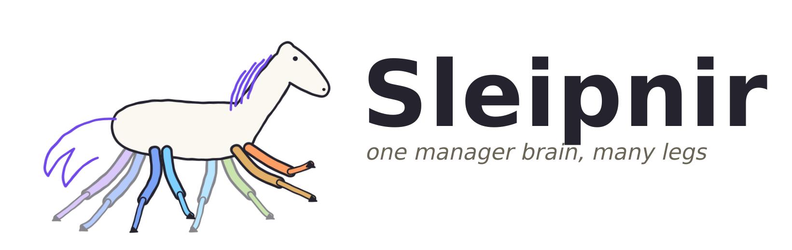

<h1 align="center">
  <picture>
    <source media="(prefers-color-scheme: dark)" srcset="docs/media/logo-wordmark-dark.svg">
    
  </picture>
</h1>

[](https://github.com/Anemos-labs/Sleipnir/actions/workflows/ci.yml)
[](https://github.com/Anemos-labs/Sleipnir/actions/workflows/codeql.yml)
[](https://github.com/Anemos-labs/Sleipnir/releases)

Sleipnir is a terminal and browser coding agent for local and hosted models. It
runs as a single agent, or as a team where a manager divides a task among
specialist workers, reviews what they produce, and verifies it before calling it done.

### Benchmark

[Aider Polyglot](https://github.com/Aider-AI/polyglot-benchmark), 60 tasks in six languages. Each harness ran
with the same model on the same endpoint, given the same prompt, and was graded by the same tests.

| Muse Spark Open | Pass rate | $ per solved task | Cache hit rate | Median time |
|---|---|---|---|---|
| **Sleipnir** | **96.7%** | **0.0093** | **90%** | **304s** |
| Claude Code | 92.7% | 0.0157 | 79% | 461s |
| opencode | 89.1% | 0.0147 | 85% | 400s |
| aider | 70.3% | 0.0155 | 47% | 1066s |

On DeepSeek V4.1 Flash, Sleipnir, opencode and Claude Code finish within two points of each other (95.0% to 96.7%),
and Sleipnir and opencode are the cheapest.
Single-agent mode, 145 to 180 runs per harness and model. The method, the per-language results and the caveats are in
[Benchmarks](docs/BENCHMARKS.md#against-other-harnesses).

**Contents:** [Install](#install) · [First run](#first-run) · [How the team works](#how-the-team-works) ·
[Goals](#goals) · [Browser interface](#browser-interface) · [Automation](#automation) ·
[Safety](#safety) · [Documentation](#documentation) · [Development](#development)

## Install

```sh
go install github.com/anemos-labs/sleipnir/cmd/sleipnir@latest
cd your-project
sleipnir
```

Requires Go 1.26 or newer. Without Go, download an archive from
[Releases](https://github.com/Anemos-labs/Sleipnir/releases).

Or let your coding agent do it: ask Claude Code, Codex or another agent to
"install Sleipnir following
https://github.com/Anemos-labs/Sleipnir/blob/main/skills/install-sleipnir/SKILL.md".
The skill installs the binary, finds the provider you already have, has you
enter your key yourself, and checks the model with `sleipnir doctor`.

<details>
<summary><code>sleipnir: command not found</code></summary>

`go install` puts the binary in `go env GOBIN` when that is set, otherwise in
`$(go env GOPATH)/bin` (usually `~/go/bin`). Add that directory to PATH and save
the line in the shell's startup file:

```sh
export PATH="$(go env GOPATH)/bin:$PATH"
```

With a custom `GOBIN`, add that directory instead. On Windows, add Go's binary
directory (normally `%USERPROFILE%\go\bin`) to the user `Path` and open a new terminal.
More in [Getting started](docs/GETTING-STARTED.md#install).
</details>

## First run

Sleipnir asks for a provider and model the first time. The recommended provider is
**Heimdallm**, an OpenAI-compatible marketplace of open models (Qwen, GLM, DeepSeek,
MiniMax, MiMo and more). Sleipnir pins each conversation to one Heimdallm engine,
so a long session can keep reusing that engine's cache:

```sh
sleipnir login heimdallm      # paste your key; or set HEIMDALLM_API_KEY
sleipnir models               # browse the catalogue, no key needed
```

Other ways in:

| With | Run |
|---|---|
| A ChatGPT subscription | `sleipnir login chatgpt` (browser sign-in, billed to your plan) |
| Another API key (OpenAI, Anthropic, OpenRouter, Gemini, DeepSeek, Groq, …) | `sleipnir login` |
| A local server (Ollama, LM Studio, llama.cpp, vLLM, …) | Start it, then `sleipnir` |

Full list and options: [Providers](docs/PROVIDERS.md).

## How the team works

The default team is one manager and eight workers, one per role: architect, scout,
backend, frontend, devops, tester, docs and reviewer. The manager plans, delegates
and reviews, and handles small requests itself. Workers start only when needed.

| Flag | Effect |
|---|---|
| `--swarm 0` | A single agent, no team |
| `--swarm N` | N workers (at least 8) |
| `--role-model ROLE=MODEL` | A model per role, repeatable |

`Ctrl+G` (or `/agents`) opens the live team view. Details: [Team protocol](docs/SWARM-PROTOCOL.md).

## Goals

For work that needs several passes, set a goal:

```text
/goal Implement pagination, add tests, and verify the examples in the README.
```

After each turn the harness checks the result and continues while evidence is
missing. Escape interrupts and pauses the goal; `/goal resume` continues it.

| Command | Action |
|---|---|
| `/goal`, `/goal pause` | View or pause the goal |
| `/model`, `/roles`, `/effort` | Choose models and reasoning effort |
| `/research [depth] QUESTION` | Research the web into a cited wiki ([details](docs/RESEARCH.md)) |
| `/diff`, `/rewind` | Inspect or restore a checkpoint |
| Ctrl+T or `/stats` | Live usage and cache statistics |
| `/help` | Every command |

## Browser interface

```sh
sleipnir web --open
```

The same sessions in a browser: the team at work, permission questions, files,
changes, checkpoints, settings and tools. It listens on loopback only, with a
per-run token. [Interface](docs/UX.md#web-interface) · [HTTP API](docs/WEB-API.md)

## Automation

```sh
sleipnir run "fix the failing test"
sleipnir swarm 8 "implement the API and client" --verify "go test {dirs}"
sleipnir --continue
```

Other harnesses can delegate to Sleipnir too: `sleipnir mcp serve` is an MCP server whose tools start a goal, follow
it and read its result, so Claude Code, Codex or an editor can hand work to a Sleipnir team
([Sleipnir as a tool server](docs/MCP.md#sleipnir-as-a-tool-server)).

See the [CLI reference](docs/CLI.md).

## Safety

Permissions control edits and commands, checkpoints make changes reversible, and a
project's hooks, configuration and tool servers must be trusted before they run.
[Security](docs/SECURITY.md)

Cache reuse depends on the provider, model and workload; the stats panel reports
provider-measured usage, and a team does not guarantee lower cost.
[Cache design](docs/CACHE-DESIGN.md) · [Validation](docs/VALIDATION.md)

## Documentation

- **Use:** [Getting started](docs/GETTING-STARTED.md), [CLI](docs/CLI.md), [configuration](docs/CONFIGURATION.md), [providers](docs/PROVIDERS.md)
- **Extend:** [plugins](docs/PLUGINS.md), [extensions](docs/EXTENDING.md), [MCP](docs/MCP.md), [web API](docs/WEB-API.md)
- **Understand:** [architecture](docs/ARCHITECTURE.md), [team protocol](docs/SWARM-PROTOCOL.md), [interfaces](docs/UX.md), [limitations](docs/STATUS.md), [roadmap](docs/ROADMAP.md)

## Development

Go 1.26 or newer. Dependencies are limited to `golang.org/x/net`, `x/sys` and `x/term`.

```sh
go build ./...
go test -race -count=1 ./...
go vet ./...
```

[Building](docs/BUILDING.md) · [Testing](docs/TESTING.md) · [Contributing](CONTRIBUTING.md)

## License

[Business Source License 1.1](LICENSE). See the license for production-use terms
and conversion to Apache 2.0.
